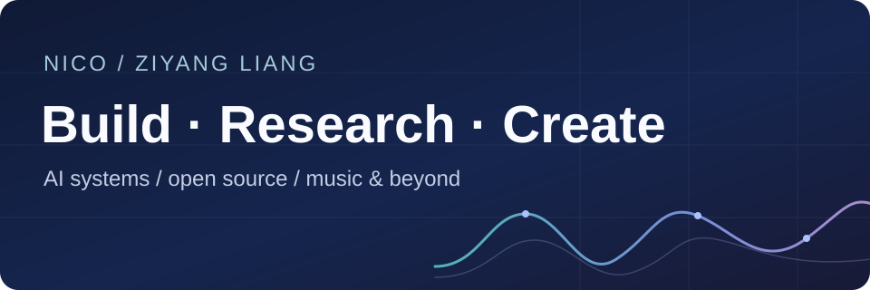

# Ziyang Liang

**Call me Yang.**

I build AI systems and explore how to make them reliable. My interests sit around agent runtimes, LLM evaluation, and model alignment.

I also make music and write. This is a home for the things I build, study, and create.

**HKUST (Guangzhou)** 
Master's, Data-Centric AI Technology

**South China Normal University** 
Bachelor's, Software Engineering

[Open source](#open-source) · [Projects](#selected-projects) · [Music](#beyond-code) · [Contact](#connect)

 

## Open source

**Contributor to [LazyMind](https://github.com/LazyAGI/LazyMind), [LazyRAG](https://github.com/chenhao0205/LazyRAG), and [awesome-agents](https://github.com/kyrolabs/awesome-agents).**

My contributions span agent completion checks, runtime reliability, skill integrations, and open-source discovery. I enjoy working on the details that make AI tools useful in everyday work.

More open-source activity

I've also proposed contributions to [FastMCP](https://github.com/PrefectHQ/fastmcp), [awesome-workflow-automation](https://github.com/dariubs/awesome-workflow-automation), [awesome-ai-agent-platforms](https://github.com/Agenta-AI/awesome-ai-agent-platforms), and [awesome-deepseek-harness](https://github.com/0xsline/awesome-deepseek-harness). These are currently in review or draft.

[Follow my contributions on GitHub →](https://github.com/pulls?q=is%3Apr+author%3ANicoYang1984+is%3Apublic)

## Selected projects

**[EcomAlign-Qwen](https://github.com/NicoYang1984/EcomAlign-Qwen)** · Owner 
An e-commerce alignment project: Qwen post-training, LoRA SFT, DPO, evaluation, and serving.

**[Superpowers completion evidence](https://github.com/NicoYang1984/superpowers-2451-completion-evidence)** · Independent experiment 
Exploring how explicit evidence makes agent reports easier to audit, with a public protocol and reproducible fixtures.

**[DPO + PairRM](https://github.com/NicoYang1984/assignment4-dpo-pairrm)** · Owner · Course project 
A small-scale preference-alignment study with Qwen2.5, PairRM, and LoRA.

More of my work: [Company relation graphs](https://github.com/NicoYang1984/llm-enhanced-stock-prediction-graph) · [Financial sentiment analysis](https://github.com/NicoYang1984/Financial-News-Sentiment-Analyzer)

## Beyond code

Music production, writing, and room to experiment.

[Listen on NetEase Cloud Music ↗](https://music.163.com/#/artist?id=53437311)

<!-- MUSIC_WORKS: Add verified track titles and public listening links. -->
<!-- PHOTO_GALLERY_START
Reserved for 2–3 real photos. Add files before activating any image.

PHOTO_GALLERY_END -->

## Connect

[Email](mailto:zliang780@connect.hkust-gz.edu.cn) · [GitHub](https://github.com/NicoYang1984) · [NetEase Cloud Music](https://music.163.com/#/artist?id=53437311)

zliang780@connect.hkust-gz.edu.cn
<!-- SOCIAL_LINKS: Reserved for verified Douyin, Bilibili, Zhihu, other music platforms, and personal website URLs. -->
